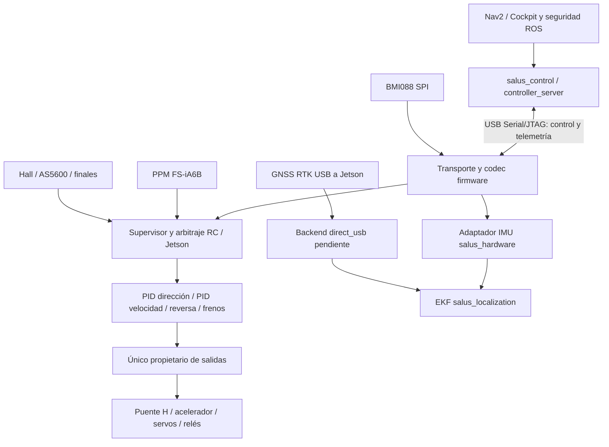

# Migración del controlador SALUS a PCB v3

Fecha: 2026-10-15. Estado: planificación inicial basada en fuentes locales;
ninguna función del robot está portada ni validada en el S3 por este documento.
Actualización: existe una [primera entrega del esqueleto](SKELETON.md), con
soporte de placa y consola USB, todavía sin control del robot.
La fabricación fue informada por el operador; no se inspeccionó una placa recibida.

## Fuentes y alcance

| Fuente | Revisión observada | Papel |
| --- | --- | --- |
| `ESP32_SALUS` | `037c1ed`, main limpio | Referencia de comportamiento; no acredita binario instalado |
| `salus-esp32s3-fw` | `7ca6aec`, main | Destino ESP-IDF; cambio local previo en `.vscode/settings.json` preservado |
| `salus_robot` | `5a4c3b7`, `agent/camera-sweep-lights` | Consumidores Jetson inspeccionados; `.agents/` local no modificado |
| `PCB_SALUS_v3` | `506cada`, main limpio | Hardware canónico; entrega `JLCPCB_2026-10-15_SALUS_v3_D9_DNP` |

Las revisiones anteriores son las del checkout, no una consulta a Jetson ni una
certificación del firmware instalado. Ver [evidencia](EVIDENCIA.md).

Leer en PCB `docs/reviews/2026-10-15/DECISIONES_Y_PENDIENTES.md`,
`CONECTORES.md` y `REVISION_COMPLETA.md`. El informe de revisión original usa
`5d39f71`; sus decisiones posteriores incorporan D9 DNP. No interpretar su
texto histórico sobre D9 montado como estado actual.

## Decisiones y propuestas

Decisiones del operador: ESP32-S3-WROOM-1-N8R2, ESP-IDF, enlace Jetson por USB
Serial/JTAG, sin detección VBUS, alimentación externa obligatoria, D9 DNP.
Conservar BOOT/RESET y capacidad de recuperación. No quemar eFuses de bloqueo.

Decisión del operador (2026-10-15): el firmware de esta placa no utilizará
Wi-Fi. No portar la conexión Wi-Fi ni OTA/Telnet del firmware clásico. La
operación remota se realizará accediendo a la Jetson Orin; desde ella se
ejecutarán las herramientas y comandos de flasheo por USB Serial/JTAG hacia
el S3. Para el operador el flasheo seguirá siendo remoto, pero el enlace
Jetson–PCB será USB. La comunicación de control y telemetría también usará
ese enlace USB. El procedimiento deberá detener/liberar el consumidor serie
antes del flasheo y contemplar reinicio, reenumeración y recuperación; no
iniciar movimiento al terminar. La PCB requiere alimentación externa durante
la programación, incluso con USB conectado.
El objetivo futuro es BMI088 SPI más GNSS RTK USB directo a Jetson, retirando
la función inercial del Pixhawk cuando exista evidencia suficiente.

Propuestas de esta planificación, pendientes de implementación: componentes
separados, dominio de control puro, UART v2 como primer contrato binario sobre
USB y extensión versionada para IMU/diagnóstico. No representan un ADR aprobado
en `salus_robot`. No se propone cambiar hoy el runtime del robot.

## Arquitectura objetivo

La seguridad local debe funcionar sin ROS, USB ni consola. La Jetson conserva
planificación, arbitraje de alto nivel y localización; el S3 conserva control
rápido, sensores de actuadores y fallos locales. El E-stop por protocolo no
acredita un circuito de corte independiente: documentar cableado real.

Componentes propuestos en `components/`:

| Componente | Responsabilidad y límite |
| --- | --- |
| `salus_board` | Un mapa de pines v3, validación de recursos y secuencia de arranque |
| `salus_protocol` | Codec puro y parser incremental; independiente de USB/UART |
| `salus_transport` | USB único para control, telemetría y diagnóstico; codec reutilizable para compatibilidad UART |
| `salus_rc` | Captura PPM, confianza, antigüedad y canales normalizados |
| `salus_sensors` | AS5600, Hall, finales y snapshots con validez/tiempo |
| `salus_control` | Políticas puras de autoridad, PIDs, freno y reversa |
| `salus_outputs` | Único escritor de PWM, puente y registro de relés |
| `salus_imu` | BMI088, calibración, marcas de tiempo y muestras |
| `salus_config` | NVS versionada, validación, defaults y exportación |
| `salus_diagnostics` | Fallos, contadores, reset reason y mantenimiento inhibido |

El diseño de tareas debe fijarse mediante presupuesto medido: ISR solo captura,
colas/snapshots acotados, tiempo monotónico y períodos explícitos. El lazo no
puede bloquear esperando USB, logs, NVS o SPI. Definir prioridad, stack, watchdog,
peor latencia y política de desborde por tarea antes del port completo. Evitar
asignaciones dinámicas en ISR/lazos; no hacer depender seguridad de PSRAM.

## Inventario de comportamiento que hay que migrar

| Área clásica | Fuentes en `ESP32_SALUS` | Trabajo y evidencia requerida |
| --- | --- | --- |
| Arranque/configuración | `src/main.cpp`, `platformio.ini` | Inventariar defaults y orden de inicialización; sustituir Arduino por IDF |
| Protocolo | `src/pi_comms.cpp`, `ESP32_UART_PROTOCOL.md` | Vectores binarios compartidos con Python, corrupción y resincronización |
| RC PPM | `src/fs_ia6.cpp`, `include/fs_ia6.h` | Port de captura RMT/GPIO a API IDF fijada; polaridad, canales, confianza y pérdidas |
| Dirección | `src/pid.cpp`, `h_bridge.cpp`, `AS5600.cpp`, `steering_calibration.cpp` | PID, wrap angular, límites, calibración, bloqueo RC, pérdida I2C y sentido físico |
| Tracción/reversa/frenos | `src/quad_functions.cpp`, `speed_pid.cpp` | Arbitraje, neutral/armado, rampas, overspeed, stall/lockout, gracia Hall, frenos y tiempos |
| Hall | `src/hall_speed.cpp` | Secuencias válidas/inválidas, dirección, timeout, geometría y captura diagnóstica |
| Persistencia | `speed_pid.cpp`, `steering_calibration.cpp` | Enumerar claves/tipos; exportar calibración real antes de cualquier reemplazo |
| Baliza/relés | `src/hazard_light.cpp`, `main.cpp` | Baliza hoy deshabilitada; asignar siete bits y polaridad con cableado real |
| Diagnóstico | `system_diag.cpp`, `freertos_utils.cpp` | Contadores de fallos y carga; trazas sin afectar el control |
| OTA/Telnet | `src/ota_telnet.cpp` | No portar Wi-Fi, OTA ni Telnet; inventariar comandos y rescatar solo diagnóstico/calibración necesarios mediante una interfaz de mantenimiento a definir |
| Batería | protocolo y consumidores ROS | No reintroducir ADC ni trama `0x56`: clásico la retiró; BMS externo en Jetson |

No trasladar credenciales Wi-Fi/Telnet a documentación ni adoptar overrides
remotos sin revisar su autoridad. El firmware fuente y sus defaults no sustituyen
un respaldo de calibraciones y configuración de la unidad instalada.

Valores caracterizados en fuente, no parámetros ya validados para la PCB v3:

- Acelerador: 20 kHz, 8 bits, duty mínimo 62 y máximo 228 de 255;
  `quadThrottleStop()` aplica mínimo, no cero. El filtro/buffer nuevo cambia la señal.
- Frenos: 50 Hz; servo A libera/aplica 15°/110°, B 130°/25°.
  Confirmar correspondencia física A/B con J17/J18 antes de energizar.
- Reversa clásica: GPIO32, LOW=REV/HIGH=FWD, 300 ms antes/después,
  límite 1.30 m/s. La nueva cadena HC595/ULN requiere verificar polaridad completa.
- Comando Jetson fresco hasta 120 ms. RC consumidor hasta 50 ms,
  sampler configurado a 75 ms y gracia de fuente RC de 150 ms: son capas distintas.
- PID dirección/drive a 30 ms; lectura AS5600 a 30 ms; sampler RC a 10 ms.
- Defaults de velocidad máxima 4.17 m/s y PID 10/2/0. Extraer el conjunto
  completo de tunings, rampas y condiciones a fixtures antes de implementar.

No simplificar el arbitraje a “RC siempre manda”: en `quad_functions.cpp`
`piBlocksRc` depende de enable, freno y E-stop frescos; el bloqueo RC tiene
prioridad propia. Dirección y tracción resuelven autoridad en caminos distintos.
Caracterizar ambas máquinas y resolver diferencias con decisión explícita.

## Comunicación y contrato de compatibilidad

Primer hito propuesto: conservar exactamente `0xAA` de 7 bytes y `0x55` de 8,
versión 2, endian, flags, sentinelas, unidades y CRC del código actual, cambiando
solo el transporte físico a USB Serial/JTAG. El CRC implementado procesa
MSB-first con polinomio 0x31 e init 0: no elegir una librería solo por el nombre
Dallas/Maxim. Jetson transmite a 50 Hz y firmware informa a 100 Hz en las fuentes.
115200 8N1 describe UART; no es una garantía de caudal/latencia USB.

USB no preserva límites de trama: manejar fragmentos, múltiples tramas por
lectura, ruido, bloqueos de escritura, reset y reenumeración. El timestamp de
recepción de una trama válida determina freshness; bytes sueltos y CRC malo no
renuevan autoridad. Vaciar comandos pendientes tras reconexión y exigir rearme
según contrato a cerrar; nunca reproducir una orden anterior al reset.

El canal binario operativo no debe mezclar `printf`, consola, logs de arranque
ni monitor concurrente. Definir rutas y exclusión de propietarios del puerto;
Por decisión del operador, diagnóstico, logs y depuración también deben
viajar por el mismo cable USB que control, telemetría y flasheo. No depender
de UART0/J1 para el uso normal. Definir un canal de diagnóstico con framing
explícito dentro del protocolo USB, para separar logs de las tramas binarias;
no insertar texto libre entre tramas v2. USB Serial/JTAG será la vía de
depuración JTAG por ese mismo cable; validar coexistencia y herramientas en
Jetson. El flasheo y las sesiones que detengan la CPU requieren modo de
mantenimiento con propulsión inhibida. El `sdkconfig` local previo duplicaba consola a
USB: no es protocolo bidireccional. Fijar la configuración reproducible y probar
el efecto de flasheo/JTAG, que interrumpe o puede detener el control.

UART debe permanecer documentada y con codec reutilizable; J4 comparte redes
con RS485 y no se habilita como un segundo enlace independiente. No inferir que
“preservar UART” obliga a usar J4 como enlace operativo cuando se eligió USB.

La IMU no cabe en las tramas v2. Antes de publicarla elegir mediante ADR una
extensión con framing inequívoco o protocolo nuevo negociado. Definir versión,
tipo, longitud máxima, integridad, secuencia, tiempo de adquisición, boot/session
ID, unidades, errores, capacidades y prioridad de control sobre sensores. No
emitir tramas nuevas a un parser antiguo sin prueba de compatibilidad. Un único
lector Jetson deberá demultiplexar: dos procesos no pueden consumir el mismo
puerto serie. Si se modifica v2, sincronizar firmware, Python, fixtures y docs.

## Integración Jetson e IMU/GNSS

`salus_control` ya tiene `control_real_uart.launch.py`, transporte pyserial y
`serial_port_resolver.py`. El selector prioriza CP2102 y fallback ttyUSB/serial0:
no acredita identificación segura del S3 frente a un GNSS USB. Crear identidad
estable por dispositivo, permisos y pruebas con ambos conectados; revisar DTR/
RTS, exclusividad, reconexión y mapping del contenedor. Mantener fallback clásico
solo por perfil explícito; evitar seleccionar por accidente GNSS o BMS.

En `salus_hardware` deberá vivir el adaptador BMI088 a `sensor_msgs/Imu`;
contratos compartidos nuevos en `salus_interfaces`, composición en
`salus_bringup`, TF/montaje en `salus_description`, configuración de fusión en
`salus_localization`. Antes de modificar esos repositorios redactar intent y ADR,
actualizar `docs/migration-status.yaml` y package map donde corresponda.

El EKF `localization_local_real.yaml` fusiona de la IMU solo
`angular_velocity.z`. Para sustituir esa entrada hay que medir signo/ejes ENU,
montaje y TF estática, sesgo térmico, ruido/covarianza, saturación, tasa y edad.
Definir QoS, productor único, lifecycle y política stale para `/salus/imu/data`.
Expresar gyro en rad/s, aceleración en m/s² y orientación no disponible según
contrato ROS; no inventar quaternion de rumbo ni covarianzas cero.

BMI088 no aporta rumbo absoluto. Revisar separadamente el perfil global y
`navsat_transform`: origen del heading, alineamiento, arranque estacionario,
rumbo en reversa y pérdida GNSS. No retirar Pixhawk tras validar solo el EKF local.

`rtk_domain.py` reconoce `direct_usb`, pero `pixhawk_rtk_adapter.py` lo rechaza
como no implementado. Pendientes: protocolo/modelo exacto de receptor, lectura
fix/covarianzas/tiempo/estado RTK, entrega RTCM, configuración persistente,
reconexión, antena/lever arm y datum. Mantener ruta Pixhawk disponible hasta
validación A/B con bags y pruebas autorizadas. GNSS directo es una línea de
trabajo propia y no bloquea caracterización de actuadores en el S3.

## Seguridad y matriz de fallos a cerrar

| Estímulo | Invariante / decisión pendiente | Evidencia |
| --- | --- | --- |
| Boot/reset/brownout | Sin impulso del puente, aceleración involuntaria o relés indeterminados; definir estado de frenos y throttle por fase eléctrica | Osciloscopio y secuencia de alimentación |
| USB perdido / Jetson colgada | Timeout local independiente; caracterizar fallback RC y rearme; no sostener orden vieja | Test con reloj virtual y HIL |
| RC ausente/corrupto/reaparece | Confianza, neutral y armado; no promoción accidental de autoridad | Capturas PPM y fixtures |
| E-stop/bloqueo RC + override | Ningún override elude la inhibición; freno y dirección según política documentada | Matriz de autoridad completa |
| AS5600/FC/Hall inválidos | No inventar medición válida; bloquear movimiento afectado según tabla de estados | Inyección de fallos |
| Cambio FWD/REV | Throttle inhibido durante retardos; definir requisito de velocidad baja y feedback inválido | Máquina temporal y banco autorizado |
| SPI/USB/NVS bloqueados | Supervisión detecta fallo sin bloquear control; salidas definidas | Sobrecarga y watchdog |
| Flasheo/debug/reset | Mantenimiento con propulsión inhibida; no prometer failsafe de software con CPU detenida | Procedimiento de recuperación |

El estado eléctrico apagado/reset no equivale al estado lógico de parada
calibrada. No sustituir duty 62 por cero, ni afirmar que mantener 62 durante
brownout sea posible. La seguridad con CPU sin ejecutar exige verificar hardware.

## Plan por entregas y gates

Estado actualizado: M0 sigue pendiente como caracterización ejecutable; no es
prerrequisito para empezar el port por módulos según decisión del operador.
M1 tiene una entrega parcial documentada en `SKELETON.md`; M2 tiene una
[entrega inicial USB](USB_PROTOCOL.md), con codec y diagnóstico pero sin
validación física ni contrato de rearme. M3–M9 pendientes.
Cada entrega tendrá commit, cambios de contrato, tests, resultados y límites.

| ID | Entrega y dependencias | Criterio de salida |
| --- | --- | --- |
| M0 | Caracterización clásica y respaldo; esta documentación es la base | Fixtures de protocolo/arbitraje/temporización/calibración y manifiesto de unidad real |
| M1 | Proyecto reproducible y board support; depende M0 y pinout | IDF fijado, target/memoria/particiones/defaults en Git, CI build limpia; quitar reinicio hello-world; salidas inhibidas |
| M2 | Codec v2 y USB, sin actuadores; depende M1 | Round-trip Python/C, corrupción/fragmentación, exclusión de consola, reconexión y recuperación probadas |
| M3 | Sensores, RC, HC595 y supervisor; depende M1/M0 | Capturas válidas, fallos y deadlines; ninguna salida activa sin habilitación de prueba |
| M4 | Dominio de control y NVS; depende M0/M3 | Tests temporales de autoridad, PIDs, límites, calibración, reversa y failsafes; recursos PWM sin conflicto |
| M5 | Integración Jetson de control; depende M2/M4 | Perfil S3 explícito, udev/contenedor, test pseudo-terminal, build/tests/smoke ROS y rollback |
| M6 | BMI088 y extensión de protocolo; depende M2/M3 y ADR | ID/lecturas/init SPI, tiempo/ejes/covarianzas; demux Jetson sin degradar control |
| M7 | Localización y GNSS directo; depende M6 y receptor definido | Backend real RTCM/fix, bags A/B, heading global resuelto y gates de calidad documentados |
| M8 | Banco integrado y recepción; depende entregas aplicables | Matriz de fallos, mediciones eléctricas/térmicas/latencias y recovery; actuadores solo autorizados |
| M9 | Prueba controlada y release; depende M5/M8, M7 para retirar Pixhawk | Operador/E-stop, maniobras acotadas, evidencia, manifest y rollback ensayado |

Puede avanzarse M0–M4 sin placa usando dominio puro, fixtures y dobles; las
conclusiones eléctricas y HIL requieren placa. M6/M7 pueden seguir un calendario
separado del control de actuadores.

## Pendientes concretos de hardware y producto

- [ ] Confirmar al recibir D9 ausente y alimentación externa para programar;
  secuencias Jetson/PCB, GND común y recuperación BOOT/RESET.
- [ ] Medir PPM FS-iA6B y niveles Hall antes de conectar entradas.
- [ ] Confirmar AS5600/pull-ups I2C y gestión de sensor desconectado.
- [ ] Cerrar asignación y polaridad de bits HC595 a reversa, hazard y auxiliares;
  validar módulos de relé protegidos y estado con OE alto.
- [ ] Especificar servos, corriente de bloqueo, fuente 7 V, pulsos/recorrido y A/B.
- [ ] Validar acelerador filtrado en reposo/máximo/reset y alimentación mínima;
  conservar calibración 20 kHz/62..228 hasta medición y decisión explícita.
- [ ] Definir exclusión UART J4 / RS485, DIR y uso real de ese bus.
- [ ] Medir 3.3 V, corriente, ripple/temperatura de regulador con carga real.
- [ ] Elegir versión IDF, particiones, estrategia de actualización y recuperación;
  revisar recursos LEDC/RMT/SPI y restricciones del S3 sin copiar canales clásicos.
- [ ] Definir receptor GNSS exacto, heading absoluto y criterios para retirar Pixhawk.
- [ ] Fijar presupuestos aceptables de latencia/jitter/edad de control e IMU antes
  de aceptar HIL; no convertir períodos nominales en garantías.

## Validación y liberación

Host: tests puros y de caracterización; protocolo contra C/Python y pseudo-terminal;
replay de sensores, wrap de contador, NVS corrupta/versiones y pérdidas de enlace.
Build: ESP-IDF fijado, clean build S3 y pruebas en CI; el hello-world no es un
smoke de robot. ROS: build, focalizados, suite completa y smoke proporcional en
Humble para cada cambio de integración. No ejecutar launches reales por defecto.

Banco inicial sin actuadores: alimentación, boot, USB RX/TX, flash/JTAG/recovery,
I2C/SPI/PPM, registros de relé y PWM medidos con cargas de prueba. Luego HIL y
actuadores únicamente con autorización explícita, E-stop y procedimiento acordado.
No afirmar seguridad funcional o equivalencia de campo por compilar.

Release conjunto: commit PCB/entrega, firmware/binario/hash, IDF/toolchain,
protocolo/capacidades, esquema NVS/calibración respaldada, ROS/Cockpit e imagen
Jetson, reglas de dispositivos y parámetros privados referenciados sin secretos.
Rollback debe contemplar la placa clásica: no flashear su binario en el S3 ni
asumir intercambiabilidad eléctrica. Conservar mapas/datums/calibraciones.

## Mejora diferida de PCB: sincronización IMU — 2026-10-15

**IMU-SYNC-001:** conservar la PCB enviada a fabricar y registrar para la
próxima revisión la conexión INT3→INT1 del BMI088 y el traslado de DR_ACCEL
hacia INT2, manteniendo GPIO14/GPIO15. Ver [requisito y conexiones](IMU_REQUIREMENTS.md).
La placa actual se integrará con adquisición y tiempos separados; no se
modifica el pedido ni se da por implementada la sincronización.

## Avance BMI088 — 2026-10-15

M6 parcial: [adquisición del BMI088](IMU_IMPLEMENTATION.md) con API Bosch fijada,
DRDY/tiempos independientes para la PCB actual y snapshot binario de diagnóstico
por USB. Verificación host con SPI simulado y build ESP-IDF; no hay validación
física ni reemplazo operativo de Pixhawk. Siguen pendientes transporte continuo
multiplexado, sincronización MCU–Jetson, calibración, montaje/TF y adaptación ROS.

## Avance calibración — 2026-10-15

[Calibración BMI088 en host](IMU_CALIBRATION.md) implementada: seis posiciones
para acelerómetro antes de instalar y ajuste explícito de giro con robot inmóvil,
conservando acelerómetro y perfil anterior. Aplicación en diagnóstico/offline;
pruebas sintéticas y regresiones correctas. Sin calibración física ni activación
ROS; sigue pendiente conectar biblioteca/perfil al adaptador de Jetson.

## Avance salida ROS — 2026-10-15

`salus_robot/docs/bmi088-ros.md` documenta el observador/comparador implementado:
consulta temporizada USB 03, gyro/accel con tiempos independientes, lectura de
calibración v1 y comparación por TF frente a Pixhawk. Build/tests y smoke con
fuentes virtuales correctos. Sin flasheo ni cambio de IMU operativa. Faltan
montaje/calibración/evidencia físicos, gateway único de control/IMU continuo y
GNSS/RTCM directo antes de retirar físicamente el Pixhawk.
